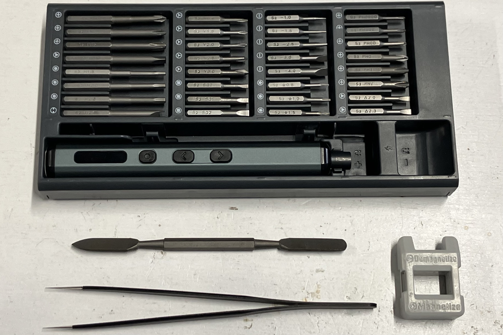
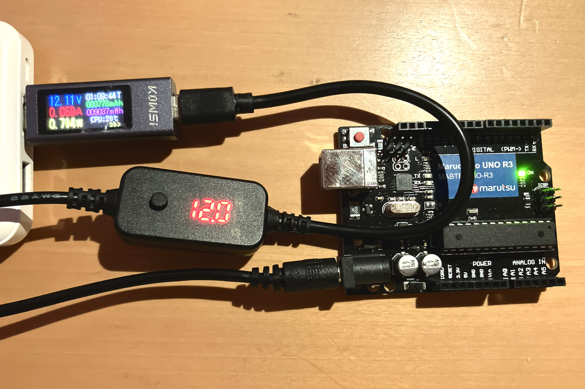
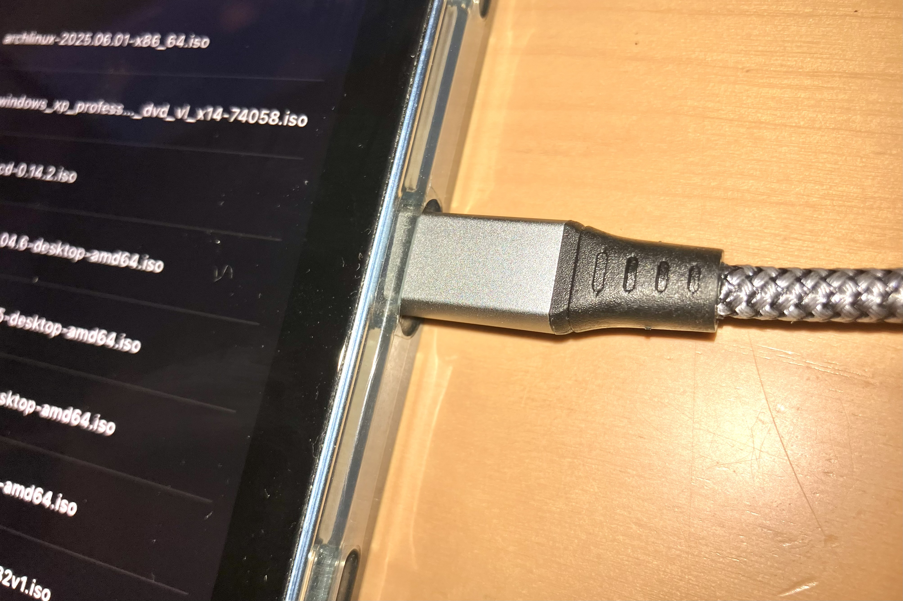
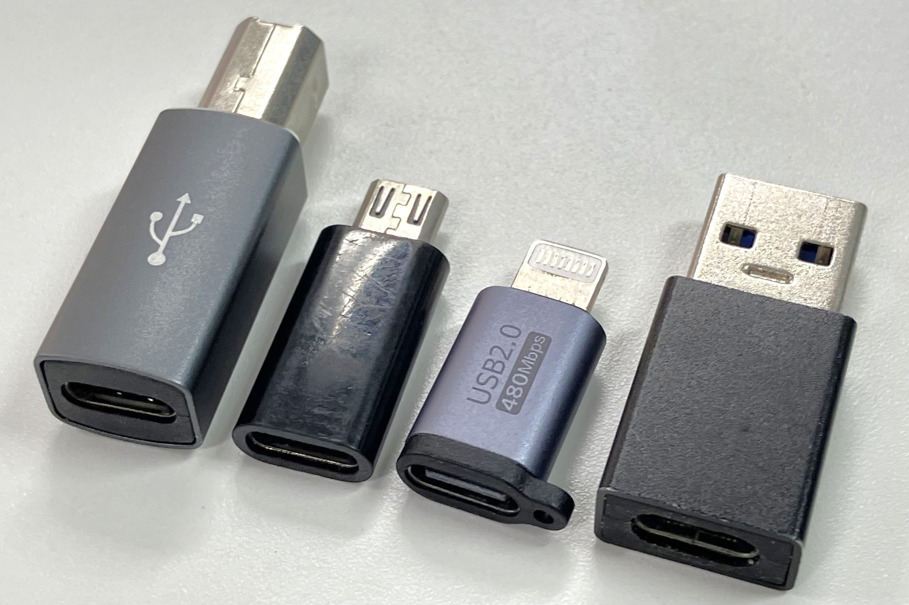
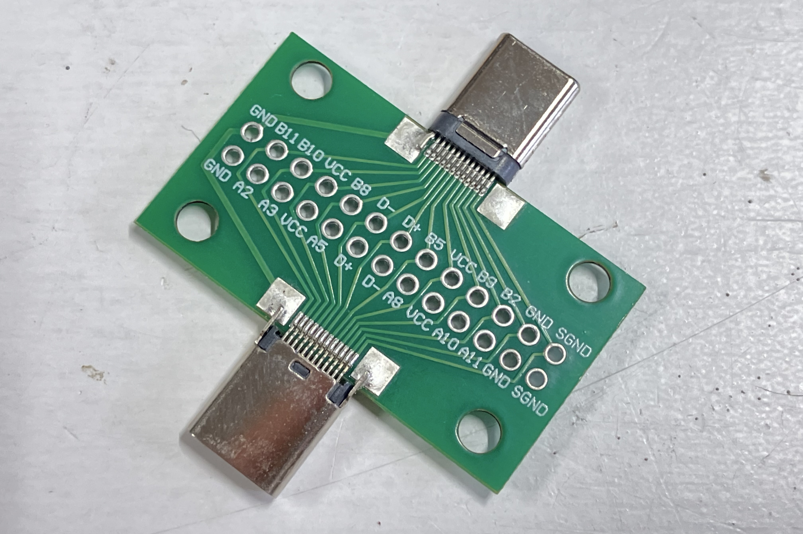

この記事は、[工学研究部 部報 第78号](https://buho.ueckoken.club/78.pdf##page=71)に掲載した記事を、無料公開に際してブログにも転載したものです。掲載時から加筆修正が含まれる場合があります。変更点は[GitHub](https://github.com/DG-7D/dg7.dev/blame/main/src/content/blog/20251001-type-c/index.mdx)でご確認ください。

## Type-Cとは

USB Type-Cとは、USBのコネクタの一種であり、また、その周辺のもろもろの規格である。従来のUSBとの互換性はもちろんあるし、名前的には単なる「USBの端子」という感じもするが、実際には従来のUSBの拡張に留まらない多くの機能を持つ。

Type-Cの大きな特徴としては、向きがないことが挙げられる。コネクタに表裏がないというのはもちろんのこと、ホスト側、デバイス側の区別もない。ホストとデバイスの区別がないということは、電源の供給元 (ソース) と供給先 (シンク) の区別もないということである。これでは誤ってソース同士を接続してしまうことが起こりうるが、Type-Cには信号線とは別で用意されたCCラインがあり、これを用いて相手がソースかシンクかを判別し、シンクであることが分かってから電源供給を開始することで、電源が並列で接続されてしまうことを[防いでいる](https://www.usb.org/document-library/usb-type-cr-cable-and-connector-specification-release-24)。逆に言えば、従来のAからは問答無用で5 Vが出力されており、万一規格違反のA to AケーブルでA同士を接続してしまうと、通信しようがないのはもちろん、5 V電源同士がかちあって過電流が流れる等の問題が起こる。まれに「端子がType-CだがPD充電器からは充電できない」製品があるが、これはCCラインのプルダウン抵抗が入っておらず、Type-Cのソース側 (PD充電器に限らない) から相手がシンクだと認識できないためである。AからはCCライン関係なしに5 Vが得られるため、A to Cであれば充電できるという挙動になる。

Type-Cでの電源供給はUSB PDのイメージが強いが、標準で得られる5 V電源も、従来は500 mA (USB 2.0) や900 mA (USB 3.0) であったのが1.5 Aか3 Aに増えている。シンクは500 mAしか引いてはいけないのか3 A引けるのかを判別する必要が生じ、これはCCラインのプルアップ抵抗によって判別される。A to Cケーブルではケーブル内でCCラインを特定の抵抗値でプルアップし、相手はAであり1.5 Aも引けないということをC側に伝えている。

このCCラインはUSB PDの通信にも使われるが、上記の通りC to Cケーブルとして機能するためにはCCラインが必要であるため、(機能する) C to Cケーブルはすべて「PD対応」であるといえる。eMarkerなしのケーブルでのPDは3 Aまでなので、あらゆるC to Cケーブルは3 Aの電流を流されうることになる。しかしながら、この世には「PD非対応、最大2 A」などと主張する謎のC to Cケーブルも存在しており、万一本当であれば「PDが動作してしまうがその電流には耐えられない」激ヤバアイテムということになる。

前置きが長くなったが、今回はそんなしっかりした規格であるType-C関連の商品を、規格や秩序といった概念からはまあまあ離れた世界であるAliExpressで買い漁った話をする。

## はんだごて

まずは比較的真っ当な商品から紹介する。知っての通り、Type-Cを用いたUSB PDでは従来のUSBとは比べものにならない大電力をきちんと規格化された方法で供給することができる。これにより、消費電力の大きいデバイスであってもUSB給電で動作させることができるようになった。

USB PDによって駆動できるようになったものの一つにはんだごてがあり、ALIENTEKの製品が有名である。これを使えば、コンセントがない場所でもある程度の出力のモバイルバッテリさえあればはんだづけができる。

実績のある製品としては、65 W対応のT65と、100 W対応のT80がある。どちらも秋月電子等の国内実店舗でも取り扱いがある。T65は互換品のこて先が多く安価に入手できるが、T80は高価な純正品しかないため、自分はT65を購入した。付属品にはいろいろなバリエーションがあるが、K型こて先のみのものを選び、追加でBC2型の互換品を購入した。

")

最近新たにT90シリーズが登場したが、このシリーズでは65 W, 130 W, 140 Wの3出力が同一シリーズのバリエーションとしてまとめられている。また、なぜかこて先と出力との対応関係がシャッフルされており、T65のこて先が使えるのは140 WのT90Cとなっている。公式販売ページの画像が分かりやすいが、自動で最大の電圧を選んでくれる、蓋がある、筐体がアルミ製、などT65で不便だった点が改善されている。まだ実際に使った話を聞かないので保証はできないが、カタログスペックを見る限り優秀そうで、予算に余裕のある人はこちらのほうがよいかもしれない。

## 電動ドライバ

Type-Cで充電できる電動ドライバも購入した。ザ・工具という感じの大げさなものではなく、よくある精密ドライバセットの電動版のようなもの。はんだごてとは異なりバッテリ駆動で、充電には大電力を必要としないため、Type-Cである必然性はないが、他の機器と同じ方法で充電できるのは便利である。AliExpressだと色々なものがあるが、AmazonでHEARTHFUNを名乗る販売者が売っていて、知り合いも使っていたやつと同じ見た目のものを選んだ。BRIGHT DIYなる日本の業者も同じっぽいものを輸入販売している (お試し輸入にクラウドファンディングを使う系のやつ)。

ケースをすっぽり覆うカバーがついていて、ラジカセの蓋のような仕組みで固定される。持ち運びに便利だが、ちょっとした振動でも固定が外れてしまうなど、雑な製品である。ケースに収納したままでも充電できるようになっているなど、気の利いたところもある。トルクはあまり強くないが、むしろネジを破壊する心配がないとも言える。

やたら鋭くて危険なピンセットと、外装の分解に使えそうな金属製のヘラも付属していた。ケースにはマグネタイザ (着磁/消磁ができるやつ) 部分もついていたが上手く機能せず、販売側もそれを承知しているのか、独立したマグネタイザ (こちらはちゃんと機能する) がセットになっていた。

ちゃんとしたメーカーではPanasonicもType-C充電の電動ドライバを出しているが、サイズが大きめのドライバくらいあって持ち運びには適さず、また、ビットの種類も少ない。用途によってはこちらもよいかもしれない。

## PDトリガケーブル

DCジャックで給電するタイプの機器は今でも一定数あり、また、自作機器で使うこともあるが、電圧ごとにACアダプタを用意するのは面倒だし、持ち運びとなれば絶望的である。一方で、USB PDでは単一の充電器から5 V, 9 V, 15 V, 20 Vと一部機器では12 Vの電圧を可能な範囲から選択して供給することができる。

PDトリガケーブルは、PD充電器に対して任意の電圧を要求し、その出力を別の端子に流すケーブルである。自分が購入したものはボタンを押すごとに電圧を切り替えられるタイプで、Amazonでも似たような見た目のものが売られている。

## Type-Cテスタ

Type-CにはPDがあるため、電圧は5 Vとは限らず、電源ラインの電圧を知る必要が生じることがある。そこで便利なのが、配線に挟むだけで電圧、電流を測定することのできるテスタである。自分が購入したものは積算電流、電力量の測定もできるようになっていたが、積算電流は正しそうな一方で、電力量が誤っているように見えた。各時刻の電力を積分するのではなく、ある時点での電圧を積算電流にかけているようで、そのタイミングによっては、主に使用したのではない電圧で計算されてしまっているように思える。まあAliExpressなのでそういうこともある。

## C to Aアダプタ

Type-CプラグとAレセプタクルを備えたケーブルも購入した。この向きでの変換自体はよくあるし、規格上も許されていて面白みはないが、よく見るものはケーブルなしで直に変換するタイプである。ケースに入れたiPadなどではType-C端子周りに空間がなくアダプタが干渉してしまうことがあるため、あまり見ないケーブル付きのものを選んだ。小さくてもType-C端子の周りが細いやつがあったらそのほうが良いかもしれない。予算が余ったから買っただけで、スマホにはType-Cがないし、iPadはそもそもあまり使わないし、PCにはAが普通にあるので、あまり用途はない。ごくごくまれに必要になるが、果たして次はいつになるだろうか。

## C to Bアダプタ

こちらはType-Cがレセプタクルで、Bプラグに変換できるアダプタ。C to A、C to Micro-BとC to Lightningのやつはすでに持っていて、C to Mini-Bのやつは注文したが届かなかった。許されているタイプのアダプタと見た目は似ているが、Type-Cレセプタクルを備えたアダプタは全て規格違反である。これを使うとこの世に存在してはいけないケーブルを生み出すことができ、先述したような電源の衝突等の問題が起きる。しかし、仕様を把握したうえで、規格上許されているケーブルと同等のものを作るのに使えば、持ち運ぶケーブルの本数を減らしてQOLを上げることができる。

なお、ちゃんとしたメーカーの部類であるAinexもC to Aのアダプタを[販売している](https://www.ainex.jp/products/u32ac-mfad/)。 相手がAであることを通知するためのプルアップ抵抗が入っていることを公言しており、C to Cと組み合わせればA to Cケーブルと同等のものになる。しかし、使い方によってはA to Aケーブルを生み出せてしまう立派な規格違反品である。また、ローソンストア100ではC to Micro-Bが売られている[らしい](https://695tf.com/202203-lawson100-typec-goods/)。ダイソー、セリア、キャンドゥといったその辺の百均には、意外とこういったあからさまな規格違反品はない。

## テスト基板

Type-Cプラグとレセプタクルの間に、各ラインに繋がったスルーホールがあるだけの基板も存在する。プルダウン抵抗が入っているかどうかなどを確認するのに使える。なお、今回購入した固体は印字が逆になっており、たとえばB11側のGNDは実際にはシールドで、B11がGND、B10がA2かB2……といった具合だった(左下を読めばよい)。さすがのAliExpressクオリティである。

## おわりに

Type-Cの仕様は複雑だと言われることがよくあるが、信号の中身はともかく、どの線にどの信号を通すかだけであればそこまで複雑ではない。ケーブルに関しても、C to Cの結線はUSB 2.0しか繋がっていないか全部繋がっているかのどちらかしか仕様上存在しない。結線のほかに、流せる電流の差や長さによる速度の差もあるが、それだけである。冷静に調べて理解を試みれば、正しく最新技術の恩恵にあずかり、人間らしい生活を送ることができる。
